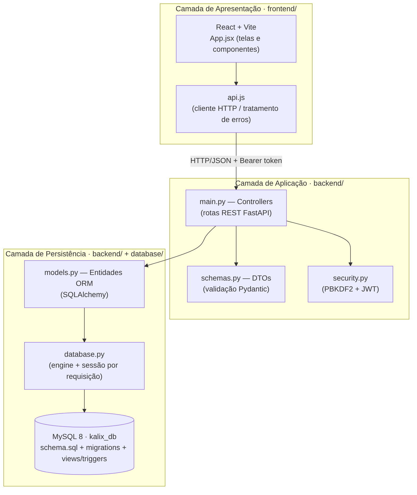

# Kalix

Plataforma web para descobrir serviços de beleza e bem-estar, reservar horários e
gerenciar a agenda de estabelecimentos.

**Projeto Interdisciplinar (PI) — 2º semestre DSM — Fatec Franca**

## 🎥 Vídeo de apresentação

▶️ [Assista no YouTube](https://youtu.be/PdKRJKEih5M?is=Ns8cmk0DXr__yuFt)

## 👥 Equipe

- Leonardo Penteado Santana
- Luan de Souza Leonel Lamarca
- Rafaela Avelar Teixeira
- Sara de Oliveira Gomes
- Yolanda Emanuely Pereira Silva Rossi

## 📚 Disciplinas envolvidas

- Engenharia de Software II
- Desenvolvimento Web II
- Banco de Dados Relacional

## 🧩 O problema

Clientes têm dificuldade para encontrar e agendar serviços de beleza, e pequenos
estabelecimentos controlam a agenda no papel ou pelo WhatsApp. No Kalix, o cliente
pesquisa os serviços e reserva o horário, e o estabelecimento gerencia equipe,
serviços e agenda em um painel.

## 🛠️ Tecnologias

- **Front-end:** React + Vite
- **Back-end:** Python + FastAPI + SQLAlchemy
- **Banco de dados:** MySQL
- **Versionamento:** Git + GitHub

## 🏛️ Arquitetura

O sistema usa **arquitetura em camadas**. O front-end conversa com a API REST, e só a
API acessa o banco de dados.



- **Apresentação:** `frontend/`, com as telas em React
- **Aplicação:** `backend/main.py`, com as rotas, regras de negócio e autenticação JWT
- **Persistência:** `backend/models.py`, com o ORM SQLAlchemy
- **Banco de dados:** `database/`, com o MySQL

## 🧱 Padrões de projeto

- **MVC:** os models estão em `models.py`, os controllers são as rotas em `main.py` e a view é o React
- **DTO:** os schemas do Pydantic em `schemas.py` validam o que entra e o que sai da API
- **ORM:** com o SQLAlchemy, as tabelas viram classes Python
- **Injeção de dependência:** o `Depends()` do FastAPI entrega a sessão do banco e o usuário logado a cada rota
- **Facade:** `frontend/src/api.js` é o único ponto de chamada à API

## 📐 Diagramas UML

Ficam em [`docs/uml/`](./docs/uml/):

- [Casos de uso](./docs/uml/casos_de_uso.png)
- [Classes](./docs/uml/classes.png)
- [Sequência: reservar serviço](./docs/uml/sequencia_agendamento.png)

## 🗄️ Banco de dados

- [Modelo conceitual](./docs/Modelo_conceitual.jpeg)
- [Modelo lógico](./docs/Modelo_logico_final.png)
- [`database/schema.sql`](./database/schema.sql): criação das tabelas para uma instalação nova
- [`database/programacao_banco.sql`](./database/programacao_banco.sql): views, triggers e procedure
- [`database/migrations/`](./database/migrations/): atualizações para bancos já existentes

**Por que MySQL:** é um banco relacional com transações e chaves estrangeiras. Isso
garante a integridade das reservas e do cashback. Também é gratuito e foi o banco
usado nas aulas.

## ▶️ Como executar

### Requisitos

- Python 3.10 ou superior.
- Node.js 20 ou superior.
- MySQL 8.0 ou superior para usar o banco principal.
- Cliente de linha de comando `mysql` disponível no `PATH` para executar os scripts SQL.

### 1. Prepare o banco MySQL

Para uma **instalação nova**, na raiz do repositório, execute:

```powershell
cmd /c "mysql -u usuario -p < database\schema.sql"
cmd /c "mysql -u usuario -p < database\programacao_banco.sql"
```

Não execute `schema.sql` sobre um banco existente. Para atualizar um banco antigo,
faça backup e siga a seção **Banco existente e migrations** em
[`backend/README.md`](./backend/README.md). As migrations não devem ser executadas
mais de uma vez.

### 2. Configure os arquivos locais

Na raiz do repositório, copie os exemplos:

```powershell
Copy-Item backend\.env.example backend\.env
Copy-Item frontend\.env.example frontend\.env.local
```

Edite `backend/.env` com as credenciais do seu MySQL e gere uma chave própria para
`SECRET_KEY`. O `frontend/.env.local` pode manter `VITE_API_URL=http://localhost:8000`
para desenvolvimento local. Esses arquivos são ignorados pelo `.gitignore`: nunca
envie credenciais reais ao GitHub.

Para executar localmente sem MySQL, configure `DATABASE_URL=sqlite:///./kalix.db` no
`backend/.env`. SQLite é uma alternativa apenas para desenvolvimento e não substitui
o banco MySQL do projeto.

### 3. Instale e inicie a API

Abra dois terminais PowerShell na raiz do repositório. No primeiro:

```powershell
cd backend
python -m venv .venv
.\.venv\Scripts\Activate.ps1
python -m pip install -r requirements.txt
python -m uvicorn main:app --reload
```

### 4. Instale e inicie o frontend

No segundo terminal, também iniciado na raiz do repositório:

```powershell
cd frontend
npm install
npm run dev
```

Abra <http://localhost:5173>. A documentação interativa da API fica em
<http://127.0.0.1:8000/docs>; o health check da API e do banco fica em
<http://127.0.0.1:8000/health> e deve retornar HTTP 200 com
`{"status":"online","database":"online"}`.

Instruções detalhadas estão em [`backend/README.md`](./backend/README.md) e
[`frontend/README.md`](./frontend/README.md).

### Publicação

Enviar o código ao GitHub não hospeda o sistema. Para disponibilizá-lo por um link,
publique o frontend, a API e o banco em serviços de hospedagem e configure as
variáveis de ambiente `DATABASE_URL`, `SECRET_KEY`, `CORS_ORIGINS` e `VITE_API_URL`
na plataforma. Nunca versione credenciais ou use o banco local de desenvolvimento
como banco público.

## 📄 Documentação

- [Requisitos (SRS)](./docs/SRS_KALIX.md)
